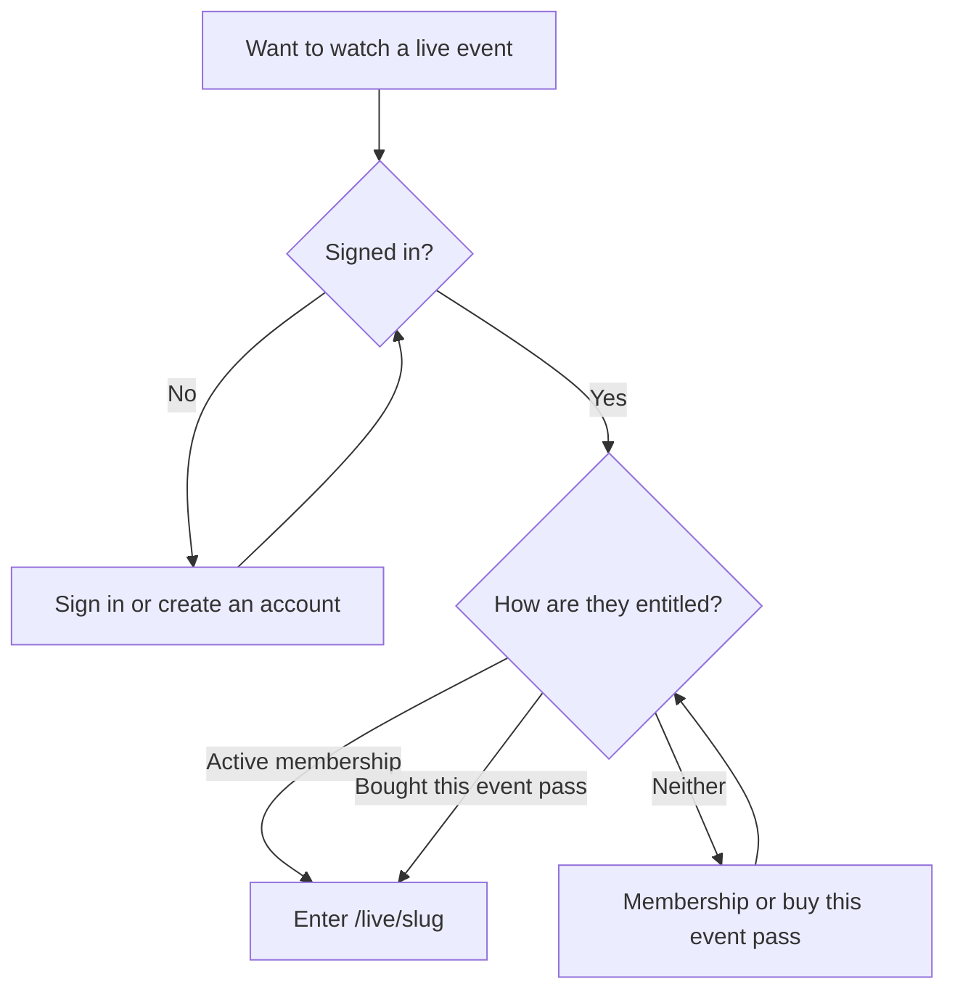
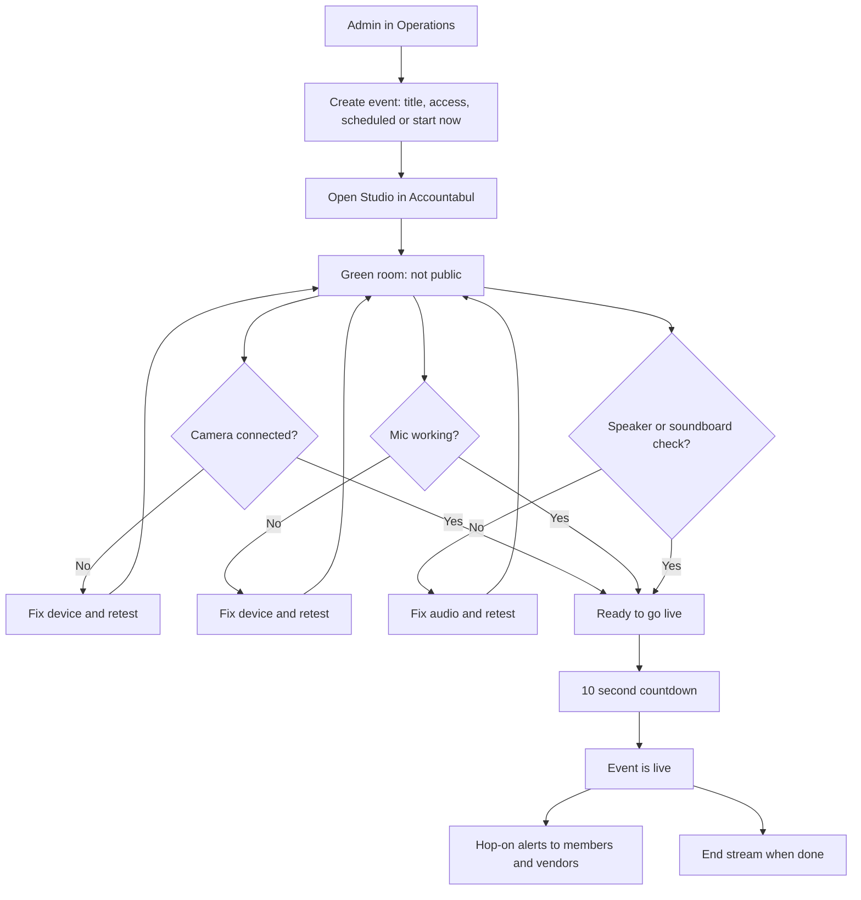
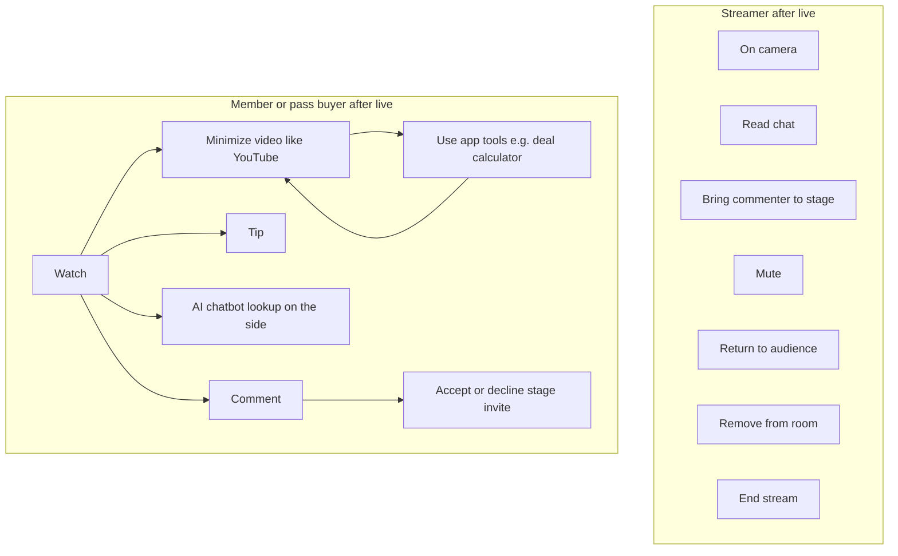

# Accountabul Live Design Spec

Status: BUILT. All ten gates are implemented, typechecked, linted, and unit tested. The done checks that require live media, a second account, or a provider credential still need a rehearsal pass; see Gate status below. Restream guest-link conference is shelved; see [CONFERENCE_ROOM_ARCHITECTURE.md](CONFERENCE_ROOM_ARCHITECTURE.md) for the frozen v1. This document is the live product.

**Rule:** Do not start the next gate until the current gate is built, tested, and signed off.

## Product

Accountabul Live is a company-hosted **live conference**. The host tests in a private green room, runs a 10-second countdown, then goes live. Entitled people are already on `/live/$slug`. They watch, comment, tip, look things up with a side chatbot, and can shrink the video like YouTube to use other app tools. If someone comments, the host sends a **same-page** stage invite. They accept, camera and mic come on (phone or computer), they talk with the host on the stream, then the host sends them back to the audience. There is no Zoom-style extra link.

```text
OPS CREATES EVENT (scheduled or now)
        ↓
HOST OPENS STUDIO → GREEN ROOM (camera / mic / sound check)
        ↓
10-SECOND COUNTDOWN → GO LIVE
        ↓
HOP-ON ALERTS (in-app, email, SMS if opted in)
        ↓
MEMBERS AND EVENT-PASS BUYERS WATCH + CHAT + TIP
        ↓
COMMENT → HOST SELECTS NAME → STAGE INVITE ON THIS PAGE
        ↓
ACCEPT → TWO-WAY CAMERA ON THE STREAM → RETURN TO AUDIENCE
```

Immediate Smoke and other room modes are later skins. They are not required to ship the conference.

## Chart 1 — Who gets in, and how



Default events are gated (`subscriber` or `subscriber_or_pass`). Signed-out visitors see `/live` and the paywall. They do not enter the room.

## Chart 2 — Admin from launch through green room to live

The Operations Console creates and edits events. It must not run WebRTC or hold media secrets. Console **Open Studio** opens the host studio in Accountabul Final.



**Scheduled:** the event is already on `/live`. Countdown still runs when the host actually goes live. Alerts may go out at schedule time and again when the stream starts.

**Now / random:** create or pick an event, pass green room, countdown, go live, then alerts fire: “We’re live. Hop on? Yes / No” plus the event link.

Green room is host-only. The audience does not see device tests. Countdown may be visible to people already on the event page after the host commits to go live.

Host camera never goes public until countdown finishes.

## Chart 3 — Streamer vs audience inside the live event



v1 stage size is **host + one caller**. Audience cameras never turn on until they Accept.

## Chart 4 — Hop-on notification

```mermaid
flowchart LR
  live[Go live] --> who[Members and vendors]
  who --> inApp[In-app live banner and schedule]
  who --> email[Email with Yes hop on and link]
  who --> sms[SMS only if they opted in]
  inApp --> page[/live/slug]
  email --> page
  sms --> page
```

SMS is not a blast to every phone on file. It goes only to people who opted into live text alerts. Email and in-app go to entitled members and to vendors with a signed-in Accountabul user. The link always opens `/live/$slug`, not Zoom or Restream.

## Entitlements

| Person | Watch | Comment | Tip | Take stage | Host studio |
| --- | --- | --- | --- | --- | --- |
| Signed-out | No (gated default) | No | No | No | No |
| Active / trialing member | Yes | Yes | Yes | Yes, if present in the room | No |
| Event-pass buyer for this event | Yes | Yes | Yes | Yes, if present in the room | No |
| Host / operator | Yes | Yes | Yes | Always on stage while live | Yes |

`canTakeStage` is the Live primitive. Legacy Restream `canRequestSpeaker` stays membership-only and is not used on this path.

Not eligible for stage: people who already left, anonymous paid-guest text with no live session, imported Restream comments.

Pass buyers do not gain other membership benefits. They gain this event’s watch, comment, tip, and stage-invite rights.

## Architecture

- **Ops console:** create/edit event, Open Studio, cancel/end. No WebRTC.
- **Host studio** in Accountabul Final (operator session): green room, countdown, go live, stage controls, end stream.
- **Audience** `/live/$slug`: watch, chat, tip, AI side chat, accept invite.
- **Mini player:** app-shell dock so navigation (calculator, listings) does not kill the stream.
- **Media:** Cloudflare RealtimeKit webinar (WebRTC) is the selected live engine. Accountabul's server creates meetings and participants and returns a participant-specific auth token only after checking the user's event entitlement.
- **Presets:** `accountabul_host` can publish and manage stage requests. `accountabul_viewer` joins view-only. The custom UI hides viewer-initiated request-to-speak; clicking a comment lets the host call `meeting.stage.grantAccess([participantId])`. The viewer must still accept inside Accountabul before calling `meeting.stage.join()`.
- **Return to audience:** the host calls `meeting.stage.kick([participantId])`; this removes the caller from the stage without removing them from the meeting.
- **Identity mapping:** every RealtimeKit participant uses the Accountabul user UUID as `custom_participant_id`. RealtimeKit meeting and participant IDs are provider identifiers, never authorization claims.
- **Cloudflare Stream:** optional replay delivery only. RealtimeKit can create composite recordings and exposes recording status through webhooks. Recordings retained by RealtimeKit must be copied before their seven-day expiry. Cloudflare Stream's WebRTC broadcasts cannot currently be recorded, so Stream is not the live-room engine or the recording source.
- **Credentials:** `CLOUDFLARE_ACCOUNT_ID`, `CLOUDFLARE_REALTIMEKIT_APP_ID`, and `CLOUDFLARE_REALTIMEKIT_API_TOKEN` are server-only. Staging and production use separate RealtimeKit apps.
- **Restream:** shelved. Do not use guest/speaker links. Do not delete history.
- **Tips:** existing conference tip flow must work while the event is `live`.
- **Deal calculator:** does not exist in this repo until Gate 10.

## Sequential gates

Each gate has a done check. The next gate does not start until that check passes. If a gate fails rehearsal, fix that gate.

0. **Spec.** This file. Done when it matches the approved plan.
1. **Entitlements.** Pass buyers `canComment` and `canTakeStage`. Done when `tests/conference.test.ts` covers member / pass / signed-out.
2. **Green room.** Ops Open Studio then camera preview, mic meter, speaker/sound check. Event stays not live. Done when the host can fail a device, fix it, and see checks without the audience seeing them.
3. **Countdown and go live.** Integrate Cloudflare RealtimeKit, issue host/viewer tokens server-side, run the 10-second countdown, join/publish only after zero, and support End stream. Done when a second entitled account watches the real camera after countdown and sees nothing during green room.
4. **Hop-on alerts.** Scheduled and now-live. In-app banner + email with Yes/No and link. SMS only with opt-in. Done when a test member and a test vendor receive the alert and the link opens `/live/$slug`.
5. **Chat.** Commenting on the live page. Done when two accounts see messages in realtime and moderation still fail-closes.
6. **Tips.** Done when a sandbox tip completes during a live event.
7. **Stage call-in.** Comment name to invite to accept to two-way to return to audience. Done when a phone and a computer each complete one call-in without a second URL.
8. **Mini player.** Done when leaving `/live/$slug` keeps the live video in a dock/PiP, then restore full screen.
9. **AI side chatbot.** Done when a user on the live page can ask a lookup question and get an answer without leaving chat/video.
10. **Deal calculator.** Build the calculator page and keep the mini player up while using it. Done when the host can show the tool on stream and a user can run the same tool in-app with video still visible.

## Gate status

| Gate | Code | Verified by | Still needs |
| --- | --- | --- | --- |
| 0 Spec | Done | This document | - |
| 1 Entitlements | Done | Unit tests: member / pass / signed-out | - |
| 2 Green room | Done | Operator-gated studio, device checks | Manual device-failure pass |
| 3 Countdown and go live | Done | Unit tests on the state machine; countdown cannot be skipped server-side, and the Operations events API refuses to set `live` or to move a live event back to scheduled | RealtimeKit credentials, then a two-account rehearsal |
| 4 Hop-on alerts | Done | Unit tests on eligibility, channels, per-kind dedupe, scheduled and live templates, and preference validation. Members set email and text alerts under Profile; Ops sends the schedule-time announcement through `POST /api/internal/ops/live-alerts` | Migration applied; Resend and Twilio credentials |
| 5 Chat | Done | Realtime subscription already shipped; RLS restricts reads to `moderation_status = 'approved'`, so moderation fails closed | Two-account rehearsal |
| 6 Tips | Done | Existing tip flow already accepts `live`; covered by the tip eligibility test | Sandbox tip during a live event |
| 7 Stage call-in | Done | Server re-checks entitlement before granting publish rights; unit tests on invitability. Host removal is recorded as an event-scoped ban, so the removed person is refused a new media token and loses chat for that event | Phone and computer rehearsal |
| 8 Mini player | Done | Room mounts above the router and portals into the page container | Manual navigation pass |
| 9 AI side chatbot | Done | Unit tests on validation, history trimming, and the advice guardrail | `ANTHROPIC_API_KEY` |
| 10 Deal calculator | Done | Unit tests against the standard mortgage formula and degenerate inputs | - |

### What a rehearsal still needs

These are environment and credential steps, not code:

- `CLOUDFLARE_ACCOUNT_ID`, `CLOUDFLARE_REALTIMEKIT_APP_ID`, `CLOUDFLARE_REALTIMEKIT_API_TOKEN`, with `accountabul_host` and `accountabul_viewer` presets created in the RealtimeKit dashboard.
- `supabase/migrations/20260916120000_accountabul_live_alerts.sql` applied, and Supabase types regenerated afterwards.
- `RESEND_API_KEY` and `LIVE_ALERTS_FROM_EMAIL` for email alerts; `TWILIO_ACCOUNT_SID`, `TWILIO_AUTH_TOKEN`, `TWILIO_FROM_NUMBER` for opt-in SMS. Each is suppressed rather than fatal when unset.
- `ANTHROPIC_API_KEY` for the side assistant.
- Two test accounts, one member and one pass buyer, plus a phone and a computer for the call-in pass.

## Success

The host opens studio from admin, checks camera and sound, hits go live, sits through 10 seconds, and the room is public. Members and vendors get a hop-on message. They watch, comment, tip, ask the side bot, shrink the video and use the calculator, and if the host picks a commenter they join on camera then go back to the audience — still in the app, never a Zoom or Restream guest link.

If the flow needs a guest link, it has failed this spec.
